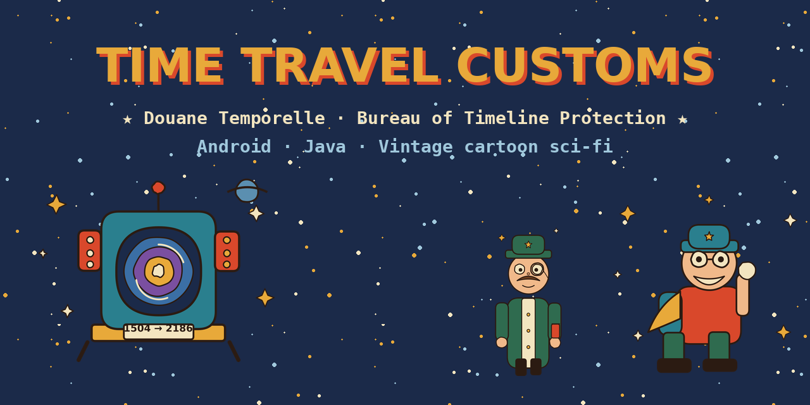
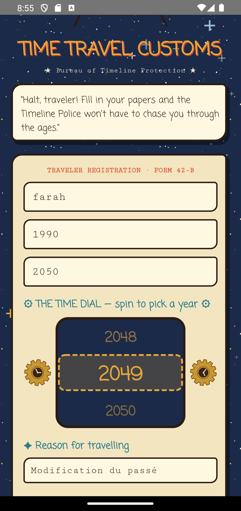
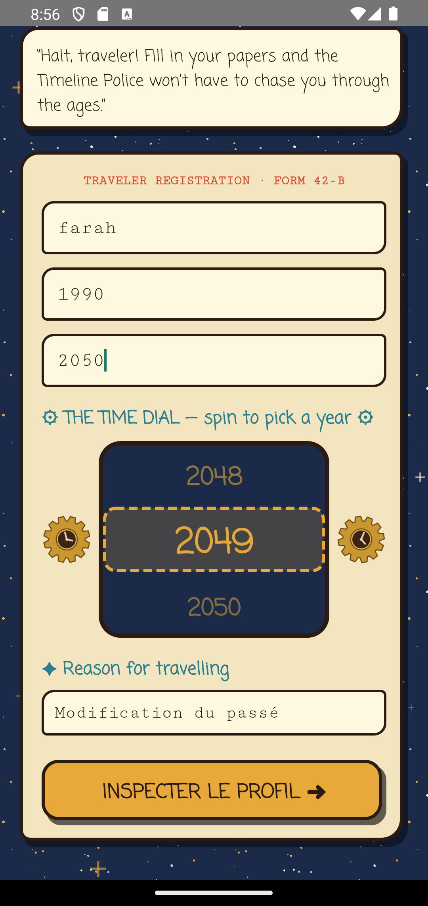
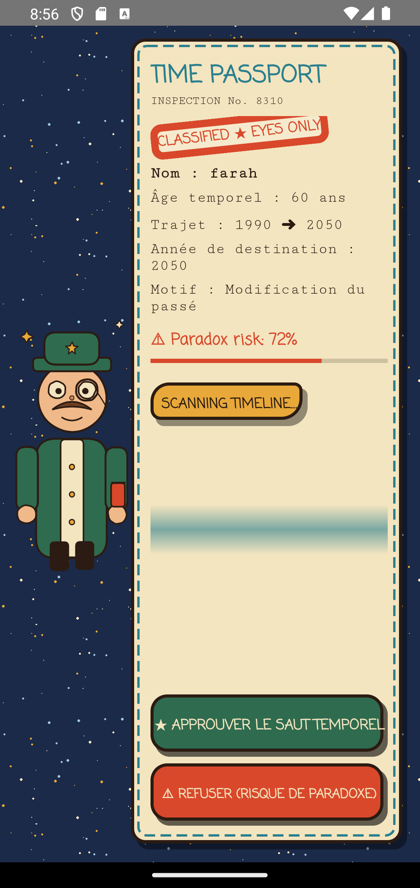
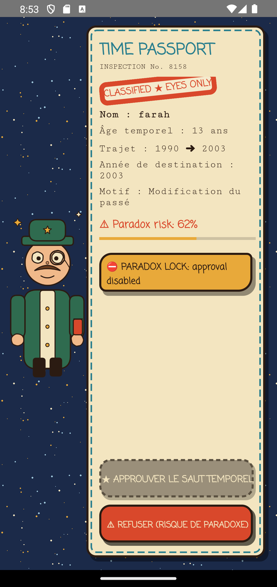
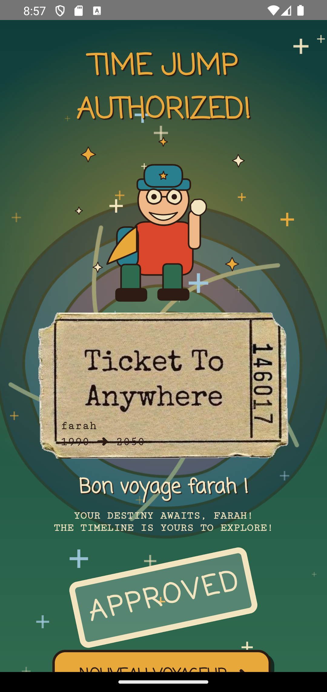
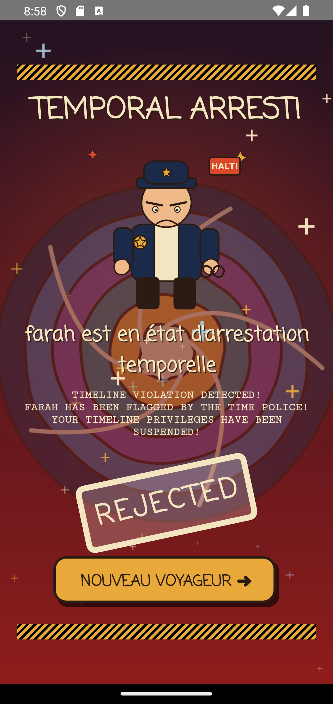
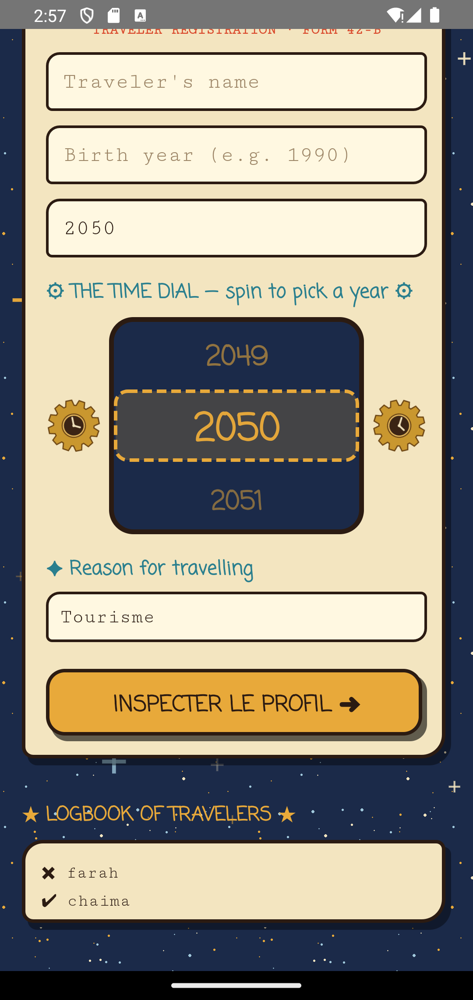

<div align="center">

# ⏳ TIME TRAVEL CUSTOMS ⏳
### *Douane Temporelle: the checkpoint where history gets inspected*
## 👥 Team
**Chaima Arfaoui grp A03 ** · **Farah Boukhatem A01 **
> 📝 **Note on commits:** Farah Boukhatem's computer crashed during the project, so she continued working on Chaima's PC and GitHub account. That is why all commits appear under a single account. Both members contributed to the project.

*FSEGT, 3ème BI, Programmation Mobile (Prof. Nidhal Jelassi)*


> *"Halt, traveler! Fill in your papers and the Timeline Police won't have to chase you through the ages."*

</div>

---

## 🚀 The pitch

Every time traveler has to pass customs. **Time Travel Customs** is an Android app where you register your trip, get scanned for paradoxes, and receive a final verdict: **a hero's send-off** or **a temporal arrest**.

It started as a three-screen mini project (Programmation Mobile, Prof. Nidhal Jelassi). We turned it into a small interactive cartoon universe, inspired by vintage sci-fi illustration and retro time machines.

**Team:** Chaima Arfaoui grpA03· Farah Boukhatem grp A01

---

## 📸 Tour of the checkpoint

<div align="center">

| 🛂 Step 1: Registration | 🕰️ Step 1: The Time Dial |
|:---:|:---:|
|  |  |
| *The booth, the officer, the form.* | *Spin the wheel to pick your destination year.* |

| 🔍 Step 2: Paradox scanner | 📄 Step 2: The Time Passport |
|:---:|:---:|
|  |  |
| *The scanner sweeps your file.* | *Your inspection file and the paradox risk.* |

| ✅ Step 3: Approved | ⛔ Step 3: Rejected |
|:---:|:---:|
|  |  |
| *Time jump authorized. Destiny awaits.* | *Temporal arrest. The Time Police are here.* |

| 📖 Bonus: Logbook of travelers |
|:---:|
|  |
| *Every verdict is written in the logbook.* |

</div>

---

## 🎮 How the journey works

```
 ┌──────────────────┐   Intent    ┌───────────────────────┐   Intent    ┌────────────────┐
 │   MainActivity   │ ──────────▶ │  VerificationActivity │ ──────────▶ │ ResultActivity │
 │  Registration    │             │   Paradox Scanner     │  verdict +  │    Verdict     │
 └──────────────────┘             └───────────────────────┘    name     └───────┬────────┘
          ▲                                                                       │
          └───────────────────── "Nouveau voyageur" (clears the stack) ───────────┘
```

1. **Registration:** enter your name, birth year, destination year and reason (*Tourisme*, *Modification du passé* or *Fuite*). Type the year or spin the **Time Dial**, then press **Inspecter le profil**.
2. **Inspection:** a Time Passport shows your name, **temporal age** (destination year − birth year), trip, reason, an inspection number and a **paradox risk** bar. Then choose **Approuver le saut temporel** or **Refuser (Risque de paradoxe)**.
3. **Verdict:** the whole scene changes with the decision.
   - ✅ **Approved:** green and gold scene, a hero in front of a spinning portal, a ticket with your trip, and *"Bon voyage [Nom] !"*
   - ⛔ **Rejected:** red siren, caution tape, a grumpy time-police officer, and *"[Nom] est en état d'arrestation temporelle"*

---

## ✨ Things that move

We wanted the app to feel alive without making it heavy:

| Effect | Where |
|---|---|
| 🌀 Portal zoom-and-spin transition | Every screen change |
| ⭐ Twinkling, floating stars (custom Canvas view) | Background of all screens |
| ⚙️ Two gears turning in opposite directions | Around the Time Dial |
| 🛸 Floating time machine | Registration screen |
| 🎚️ Year wheel that shrinks and fades away from the center, with a tiny vibration on each year | Time Dial |
| 📡 Scanner bar sweeping the passport | Inspection screen |
| 🔴 Stamps that slam down with a bounce | CLASSIFIED / APPROVED / REJECTED |
| 🎆 Burst of stars and a pulsing button | Approved screen |
| 🚨 Pulsing red siren and a trembling officer | Rejected screen |

All animations are simple property animations, and they are stopped when a screen closes.

---

## 🎨 Mood board and design choices

Our starting point was a Pinterest search for **"sci fi time traveling"**.

| 📌 On the board | 🎯 In the app |
|---|---|
| Retro robot-like **time machine** in teal, red and cream | The time-machine booth on the first screen, and the color palette of the whole app |
| **Time Traveler Club** badge, antique clocks, old poster lettering | Handwritten-style titles, typewriter text for official forms, clock and star decorations |
| **Railroad ticket** collage, "Time travel for free" paper scrap | Paper-colored cards, dashed passport borders, the "Ticket To Anywhere" for approved travelers |
| **Man in a green coat at a space bus stop**: calm, mysterious, funny | The customs officer's green coat, hat and monocle |
| Blueprints, warped grids, wormholes | The spiral portal behind the verdict |
| Starry night skies | The deep navy starfield shared by all screens |

**Our rules:**
- 🌍 **One universe, three moods:** the same stars, paper and thick ink outlines everywhere.
- ✏️ **Hand-drawn feel:** irregular corners and drop shadows, like stickers from an old adventure book.
- 🦸 **Hero vs. criminal:** approval is a celebration (gold and green). Rejection is a funny police scene (red and caution tape): dramatic, not scary.
- 👀 **Readable first:** fancy fonts for titles only; form text stays high-contrast.
- ⚡ **Light:** small images, no heavy libraries.

---

## ✅ Assignment checklist

| Requirement | Done |
|---|:---:|
| 3 activities linked by explicit Intents | ✅ |
| Verdict (boolean) **and** traveler name sent to the result screen | ✅ |
| `VerificationActivity`: horizontal `LinearLayout` root, image weight **0.3**, `RelativeLayout` weight **0.7** | ✅ |
| `putExtra` keys prefixed with a student matricule, built by a **static method** (no hard-coded keys) | ✅ |
| "Approuver" **disabled at load** if reason = *Modification du passé* and (destination − birth) is **prime** | ✅ |
| Every TextView / EditText / Button ID contains our initials (`_ca`) | ✅ |
| Result background changes with the verdict | ✅ |
| "Nouveau voyageur" returns to `MainActivity` and closes previous activities | ✅ |
| Code commented in Arabic | ✅ |
| Extra features, with total freedom | ✅ (see below) |

### 🎁 Extras we added
- Input validation (empty fields, impossible years)
- Scrollable **Time Dial** with snapping and vibration
- **Paradox risk** score with a colored bar
- **Logbook** of past travelers and verdicts
- Inspection numbers, stamps and a full animated cartoon universe

---

## 🗂️ Project structure

```
app/src/main/
├── java/com/example/douane/
│   ├── MainActivity.java          # registration form + Time Dial
│   ├── VerificationActivity.java  # passport, paradox risk, prime rule
│   ├── ResultActivity.java        # verdict scenes
│   ├── Cles.java                  # static builder for Intent keys
│   ├── Historique.java            # logbook of travelers
│   ├── TwinkleView.java           # custom starfield view
│   └── Fx.java                    # animation helper
└── res/
    ├── layout/                    # 3 screens + spinner layouts
    ├── drawable/                  # cartoon buttons, cards, stamps
    ├── drawable-nodpi/            # illustrations and textures
    └── anim/                      # portal transitions
```

---

## ▶️ Run it

1. Open the project in **Android Studio** and wait for Gradle sync.
2. Run on an emulator or a phone (tested on a Pixel 4 emulator, API 34, and on a real phone).
3. 🧪 **Try the paradox rule:** choose *Modification du passé* with 1990 → 2003 (gap = 13, a prime number). The **Approuver** button stays locked.

---

## 🛠️ Built with
Java · Android Views (XML) · RecyclerView + LinearSnapHelper · ObjectAnimator / ViewPropertyAnimator · custom Canvas View · Git & GitHub

## 🙏 Credits
- Inspiration: our Pinterest mood board on retro sci-fi and time travel.
- The illustrations (time machine, officer, hero, time police and the spiral portal) were created for this project with the help of **Claude (Anthropic)**. The paper ticket image comes from our Pinterest references.

<div align="center">

*May your timeline stay paradox-free.* ⏳

</div>
